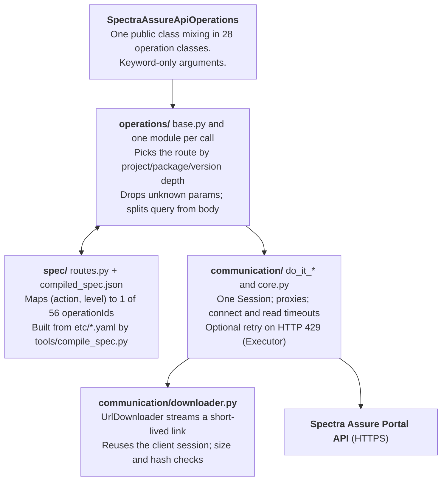

# spectra-assure-sdk: Specification

2026-10-14

## 1. Overview

spectra-assure-sdk 1.2.0 is a thin Python client for the Spectra Assure Portal API. One public class, `SpectraAssureApiOperations`, carries every call, and each call is routed through an operation table compiled from the Portal API's OpenAPI document, which covers the File Stream and the Catalog as well. 1.2.0 adds the seven Catalog calls to 1.1.0, and passes the fields the updated specification adds to existing calls (`architecture`; `overview` and `external_catalog` for a package); nothing else in the public interface changed.

This document describes the code as it stands now, and every statement in it was checked against that code. The architecture is sound, the test suite passes, and type checking and linting are clean. One issue is still open (section 7): I-31, rated low, which belongs with the Python 3.11 move planned for the next release. Section 8 is an inventory of the code the unit tests do not reach.

Reviewed: `README.md`, `Operations.md`, the package `spectra_assure_api_client/`, `tools/`, `tests_unit/`, `tests/`, `bin/`, both Makefiles, `pyproject.toml`, `doc/`, `examples/` and `etc/`.

| Check | Result |
| --- | --- |
| `pytest tests_unit` | 674 passed (398 test functions in 28 files) |
| `mypy --strict` on the package | clean, 50 files |
| `mypy` as configured in `pyproject.toml` (package, `tools`, `tests_unit`) | clean, 84 files |
| `make mypy2`: `mypy --strict` on the package, `tests`, `tests_unit` and `tools` | clean, 95 files |
| `ruff check` | clean |
| `ruff format --check` on the Python files | clean, 97 files |
| Unit-test coverage | 96% of lines (94% counting branches); 41 of 50 modules at 100%; lowest are `api.py` 86% and `spec/index.py` 87% (section 8) |
| Python versions | 3.10, 3.11, 3.12, 3.13 and 3.14: on each, all tests pass and ruff and the three mypy runs are clean (also with `--python-version` set to that Python) |
| Compiled spec against `ROUTES` | 56 operations, all routed, none missing |
| `assert` statements in the package | none |

Each issue in section 7 was checked against the code as it now stands; those marked "Reproduced" were also run.

## 2. Repository inventory

The shipped wheel contains only `spectra_assure_api_client/` (about 6,390 lines of Python plus the 36 KB `compiled_spec.json`); everything else is build, test or documentation support. `requests` (`>=2.32.2,<=2.34.2`) is the only runtime dependency, and PyYAML is needed only to rebuild the spec.

| Path | Role |
| --- | --- |
| `spectra_assure_api_client/__init__.py` | Public exports: `SpectraAssureApiOperations`, `SpectraAssureDownloadCriteria`, `UrlDownloader`, both exception families, `VERSION` |
| `spectra_assure_api_client/spectra_assure_api_operations.py` | The one public client class, a mixin of every operation class |
| `spectra_assure_api_client/operations/` | One module per public call (25 files), plus `base.py` (routing, parameter filtering, dispatch, shared helpers), `filestream.py`, `catalog.py`, `download.py` and `constants.py` |
| `spectra_assure_api_client/communication/` | Transport and configuration: `api.py` (config, base URL, helpers), `core.py` (session, proxies, retry, `Executor`), `get/post/put/patch/delete.py`, `downloader.py`, `download_criteria.py`, both exception modules, `constants.py` |
| `spectra_assure_api_client/spec/` | Internal routing layer: `routes.py` (action to operationId map), `index.py` (loads and queries the table), `compiled_spec.json` (56 operations) |
| `etc/` | The OpenAPI YAML sources: `spectra-assure-portal-public-api.yaml` (the Portal API, File Stream and Catalog included); build input only, excluded from the wheel |
| `tools/` | `compile_spec.py` (YAML to JSON), `extract_contract.py` (public-surface snapshot) |
| `tests_unit/` | 674 offline tests in 28 files: routing, File Stream, Catalog, throttling, configuration, the simple operations, downloads and their error paths, `UrlDownloader`, RL-SAFE archives, approvals, community URLs, proxy logging, proxy credentials, `make_logger`, the context manager, private internals and their deprecated names, runtime validation, query parameters and POST bodies checked against the specification, the documentation checked against the code, and the public-surface contract; `contract_snapshot.json` is the recorded surface |
| `tests/` | Integration tests that need a live Portal: a pytest suite in `tests/integration/` (33 tests), the example program, and `sweep.py`, run by `tests/Makefile` against one of five endpoints (staging, playground 1 and 2, production, Canada); `tests/README.md` describes them, `testplan.md` how they got there |
| `doc/` | One reference page per operation, `usage.md`, and generated class and package diagrams |
| `SPECIFICATIONS.md`, `p.sh` | This document; a script that applies the `*.patch` files in the working directory, committing before and after each |
| `examples/`, `bin/`, `Makefile`, `Makefile.unit_test` | Example program (identical copy of `tests/api_client_example.py`), wheel and verify scripts, build targets |

## 3. Architecture

A call passes through four layers, and the compiled routing table is the single source of truth for URLs and for which parameters are allowed.

Read top to bottom: an operation module asks `base.py` for a route, filters its arguments against what the spec declares, and hands the request to the transport. `base.py` looks the route up in `spec/` and sends through `communication/`. The downloader receives the transport's session and proxies.

- **Routing key.** `(action, level)`, where `level` comes from `_what()`: `group` with no project, `project` with no package, `package` with no version, otherwise `version`. File Stream uses the constant level `filestream`, the Catalog `catalog` and community calls `community`, so the families cannot reach each other's routes.
- **Parameter filtering.** `_accepted()` keeps only names the spec declares (query, JSON body or form) and silently drops the rest; `split_parameters()` then separates query from body. Operations that build their body from named arguments (the imports, the community calls, `rl_safe`, `status` and the File Stream calls) use `_accepted_query()` instead, which keeps only the declared query parameters, so a body field passed in `**qp` cannot end up in the URL. The Catalog calls take named arguments only and filter nothing: none of their operations declares a query parameter. No operation keeps a list of parameter names of its own. `scan` alone has a hand-written rule: `build=repro` cannot be combined with `force` or `diff_with`.
- **Request bodies.** A POST goes through `_post()`, which takes an explicit body kind: `file` (the file streamed as `application/octet-stream`), `json`, `form` (multipart) or `none`. Each operation names its kind; `create`, `scan` and `sync` take it from the media type the specification declares, and leave out an optional JSON body that has no fields. Query parameters are never sent as the body. The old `_do_it_post`, which inferred the body from the action's name, remains only for the deprecated `do_it_post` alias.
- **URL building.** `Operation.render_path()` percent-encodes every path value with no safe characters. Community URLs are assembled by hand from the spec prefix, and each value is percent-encoded as well, except that a package keeps its `/` (the namespace separator) and its `@` (an npm scope).
- **Shared helpers in `base.py`.** `_wait_for_rl_safe_archive` is the one wait loop behind both RL-SAFE downloads, and `_require_reason` checks the mandatory `reason` of approve, reject and revoke.
- **Runtime checks.** Validation is done with explicit checks that raise an SDK exception, usually `SpectraAssureInvalidAction`, so it also holds under `python -O`. The package contains no `assert` statements, and a unit test keeps it that way.
- **Pseudo-operations.** `download`, `rl_safe_download`, `filestream_download` and `filestream_rl_safe_download` orchestrate several real operations and have no route of their own (`PSEUDO_ACTIONS`).
- **Inheritance.** `SpectraAssureApiOperations` inherits 28 operation classes, each built on `SpectraAssureApiOperationsBase`, which extends `SpectraAssureApi` (config and helpers) over `SpectraAssureApiCore` (session, proxies, retry) through the `Get/Post/Put/Patch/Delete` mixins. Any operation can therefore call any other; `download` calls `list` and `status`.
- **Build pipeline.** `tools/compile_spec.py` writes `compiled_spec.json` from every `etc/spectra-assure-*.yaml`, checking that the documents share one server template and that no operationId appears twice; it reads request bodies from inline `properties` only and stops with an error, naming the operation, on a body composed with `allOf`, `oneOf`, `anyOf` or `not` (excluded operations are skipped first). It excludes the seven SCIM user-management operations, which the specification tags either `SCIM` or `SCIM (System for Cross-domain Identity Management)`. `test_tools.py` checks that the shipped JSON is what the YAML compiles to, and that the File Stream report types the SDK accepts are the ones the specification lists. `tools/extract_contract.py` records the public surface in `tests_unit/contract_snapshot.json`, which `test_contract.py` compares against. The table loads lazily and is cached for the process (`lru_cache`).

## 4. Public interface

The package root exports 18 names, and one of them is the client. Every public call takes keyword-only arguments (a bare `*` in each signature), and nearly all return a `requests.Response` without raising on HTTP error statuses.

**Exports.** `SpectraAssureApiOperations`, `SpectraAssureDownloadCriteria`, `UrlDownloader`, `VERSION`, eight `SpectraAssure*` exceptions (base `SpectraAssureExceptions`, including `SpectraAssureSpecError`) and six `UrlDownloader*` exceptions (base `UrlDownloaderExceptions`). Every exception the SDK raises derives from `SpectraAssureExceptions`; `UrlDownloaderExceptions` is a subclass of it, so one `except SpectraAssureExceptions` catches them all.

**Constructor.** All arguments are optional keywords; the mandatory ones are enforced at runtime, not by the signature. An explicit argument that is not `None` overrides the config file.

| Argument | Default | Meaning |
| --- | --- | --- |
| `host`, `server` | `None` | At least one is required. `server` of `trial` or `playground` selects `<server>.secure.software`; otherwise the base URL is `https://<host>[/<server>]/api/public/v1` (`my.secure.software` when only `server` is set) |
| `organization`, `group`, `token` | `None` | Mandatory, non-empty; failure raises `SpectraAssureInvalidAction` |
| `proxy_server`, `proxy_port`, `proxy_user`, `proxy_password` | `None` | A server needs a port; a user needs a password. With none set, `urllib.request.getproxies()` supplies the environment proxies |
| `timeout`, `read_timeout` | `None` | One setting under two names: the read timeout, 3600 s when neither is given. If both are given, `read_timeout` is used |
| `connect_timeout` | `None` | TCP and TLS connect timeout, 10 s when not given |
| `auto_adapt_to_throttle` | `None`, treated as `False` | Retry on HTTP 429, up to 5 attempts; also accepted per call |
| `no_ssl_verify` | `None`, treated as `False` | Disables TLS verification |
| `config_file` | `None` | JSON file with a top-level `SpectraAssureApi` object |
| `api_version`, `api_domain`, `api_proto` | `v1`, `secure.software`, `https` | Constructor-only; the README says they must not be changed. An empty string or `None` raises `SpectraAssureInvalidAction` (`Fatal: the <name> is not set`) |
| `**additional_args` | | Any other keyword is stored in `additional_args` and reported with a `UserWarning` that names the closest valid setting; the keyword `additional_args` itself passes through silently |

**Operations.** 26 operations accept a flat `**qp` bag. Most filter it against the spec, dropping unknown names; `audit_log_export`, `audit_log_status`, `community_user_account` and `import_profile` accept it and ignore it. The other 24 take named arguments only: `list`, `checks`, `sync`, `usage`, `list_groups` (and its deprecated old name `listGroups`), `export_profile`, ten File Stream calls and the seven Catalog calls.

| Method | Level | Verb and operation | Arguments beyond the context |
| --- | --- | --- | --- |
| `create` | project, package | POST `postProject`, `postPackage` | `description` |
| `edit` | project, package, version | PATCH `patch*` | `description`, `name`; version adds `category`, `is_released`, `license`, `platform`, `product`, `publisher`, `release_date` |
| `delete` | project, package, version | DELETE `delete*` | version: `build` |
| `list` | group, project, package, version | GET `listGroupProjects`, `listPackages`, `listVersions`, `versionInfo` | none |
| `scan` | version | POST `scanVersion`, raw octet-stream | `file_path`; `build`, `replace`, `force`, `diff_with`, metadata |
| `url_import`, `purl_import` | version | POST `importVersion`, `importVersionPURL` | `url` (must contain `://`) or `purl` (must start with `pkg:`); `auth_user` and `auth_pass`, or `bearer_token`, not both; empty credentials are left out; `replace`, `force`, `diff_with`, `max_size`, metadata. The File Stream imports follow the same rules |
| `status`, `checks`, `report` | version | GET | `status`: `build`, `download`; `report`: `report_type`, `build`. `report_type` is passed to the Portal in lowercase and checked there, on purpose, so a report type the Portal adds needs no new SDK version |
| `sync` | version | POST `syncVersion` | none |
| `approve`, `reject`, `revoke` | version | PUT | `reason`, mandatory and a string; it travels in the JSON body, and a missing or non-string one raises `SpectraAssureInvalidAction` before anything is sent |
| `rl_safe`, `rl_safe_download` | version | GET `getRlSafeVersionArchive` | `build`; download adds `target_dir`, `rename_archive`, `max_wait_time_for_archive` |
| `download` | package or version | pseudo-operation: `list`, `status`, then the download link | `target_dir`, `download_criteria`, `build` |
| `usage` | organization or group | GET | `group` |
| `list_groups` | organization | GET `listGroups` | none; `listGroups` is its deprecated old name |
| `export_profile`, `import_profile` | organization or group | GET, multipart POST | `organization`, `group`; import adds `file_path`, `replace=True` |
| `audit_log_export`, `audit_log_status` | organization | POST, GET | `name`, `datetime_start`, `datetime_end`, `should_create_cef`, `should_create_ndjson`, `filters`; `job_id` |
| `community_user_account`, `community_find_packages`, `community_report_package`, `community_report_version` | community | GET, one POST | `repository`, `package`, `namespace`, `version`; `post_data` (a list); the package report takes `artifact`, `artifact_tag`, `match_pattern`, `match_expression`, `offset` and `limit`, the version report `artifact` and `artifact_tag` |
| `filestream_*` (16 methods) | File Stream | see below | `file_id` is the only handle |
| `get_external_catalog`, `list_catalog_packages`, `import_from_catalog`, `update_from_catalog`, `publish_package_to_catalog`, `unpublish_package_from_catalog`, `detach_from_catalog` | catalog | see below | `catalog`; `project` and `package` for every call but the two listings |

The File Stream methods are `scan`, `url_import`, `purl_import`, `list`, `status`, `checks`, `report`, `sync`, `approve`, `reject`, `revoke`, `rl_safe`, `rl_safe_download`, `download`, `delete` and the static `filestream_report_types()`. `approve`, `reject` and `revoke` take a mandatory `reason` argument, and `report` supports eight types (`rl-diff` is excluded); it checks the type, unlike the version `report`, against the eight types the specification lists for File Stream reports.

The Catalog methods are named after the operation ids of the specification, in snake case. `get_external_catalog` (GET `getExternalCatalog`, `catalog`) reads an external catalog's document, and `list_catalog_packages` (GET `listCatalogPackages`) the packages published in the group's software catalog. `import_from_catalog` (POST `importFromCatalog`) takes `catalog`, `project`, `package`, `software_id` and `stream`, which are mandatory, and `versions`, `auto_sync`, `project_description`, `package_description` and `notify_on_completion`, which are optional. `update_from_catalog` (POST `updateFromCatalog`) takes `project`, `package` and optionally `versions` and `notify_on_completion`. `publish_package_to_catalog` (PUT), `unpublish_package_from_catalog` (DELETE) and `detach_from_catalog` (DELETE) take `project` and `package`. The request bodies are built from the named arguments: an optional argument left at `None` is not sent, so the Portal's default applies, while `False` and an empty list are sent. An empty `software_id` or `stream` raises `SpectraAssureInvalidAction` before anything is sent. Lengths and counts (500 characters for a description, 16 versions) are left to the Portal, as for the other calls.

**Return types.** `requests.Response` for every operation except the four download calls, and each is annotated that way. `download` and `filestream_download` return `dict | None`, `rl_safe_download` and `filestream_rl_safe_download` return `tuple[bool, str]`.

**Lifecycle.** `close()` is idempotent and the client keeps working afterwards. `with` is supported: the block gives back the same client, typed as the client so that a type checker knows its operations, and closes the session on exit, on an error too. `client.session` exposes the `requests.Session`. A client must not be shared between threads.

**Internals and deprecated names.** The SDK's internal methods carry a leading underscore (`_do_it_*`, `_execute_with_retry`, `_extract_*`, `_flatten_list`, `_get_path`, `_qp_*`, `_show_debug`, `_get_customer_context`, `_simple_path_to_posix`, `_exists_posix_path`, `_remove_temp_file_if_exists`), and the SDK calls only those names. Their 24 former public names still exist as deprecated aliases, listed in `DEPRECATED_INTERNAL_NAMES`: each call emits a `DeprecationWarning` that points at the caller and forwards to the private method, with the same signature, and a `TYPE_CHECKING` block declares them so typed callers keep full checking. They are meant to be removed in a major release, together with eight private functions that only these aliases reach and the SDK itself never calls: `_do_it_post` (with its two action tables), `_extract_purl_components`, `_show_debug`, `_qp_download`, `_qp_edit`, `_qp_reject`, `_qp_revoke` and `_get_customer_context`. Two helpers that callers use stay public: `make_logger` (a console handler at `LOG_LEVEL` and a `<program>.log` file in the working directory; calling it again replaces the handlers it installed) and `get_additional_args`. `listGroups` is handled the same way: it is the old name of `list_groups`, listed in `DEPRECATED_RENAMED`, and warns with a pointer to the new name. `dir()` therefore still shows 78 non-underscore methods on the client, and the contract snapshot still records all of them.

## 5. Configuration, transport and routing

**Configuration.** Settings come from constructor keywords and an optional JSON file. The file is read only under the top-level `SpectraAssureApi` object, and only for these keys: `host`, `server`, `organization`, `group`, `token`, `proxy_server`, `proxy_port`, `proxy_user`, `proxy_password`, `timeout`, `connect_timeout`, `read_timeout`, `auto_adapt_to_throttle`, `no_ssl_verify`.

- **Precedence.** For each key the file value is used unless the constructor argument is not `None`. The timeouts default to `None` for that reason; the built-in defaults (3600 s read, 10 s connect) apply after the merge. `timeout` and `read_timeout` are one setting: within one source `read_timeout` wins, and an argument in either name beats the file.
- **Errors.** Every problem with the config file raises `SpectraAssureInvalidAction` and names the file: a name that does not end in `.json` (in any case), a file that is missing or cannot be read, invalid JSON (with line and column), text that is not UTF-8, a top-level value that is not a JSON object, and a missing or non-object `SpectraAssureApi` section. Where the standard library raised the underlying error, such as `FileNotFoundError` or `json.JSONDecodeError`, it is kept as `__cause__`.
- **Missing settings.** When host and server, the organization, the group or the token are missing or empty, after the file and the arguments are merged, the constructor raises `SpectraAssureInvalidAction` naming only what is missing, in that order: `minimal required settings are missing or empty: token; give them as named arguments or in the configuration file`. The token's value is never part of the message.
- **Warnings.** Unknown keyword arguments and unknown keys inside the `SpectraAssureApi` section are ignored, each with a `UserWarning` (and a log warning) that names the closest valid setting. Keys outside that section are not checked.

**Requests.** Every request carries `Authorization: Bearer <token>`, `User-Agent: Spectra Assure SDK <VERSION>` and `Content-Type: application/json`; the content type is dropped when there is no body. `Executor` builds a fresh request on every attempt, reopening any upload file, and sends it through the client's single `requests.Session` with `(connect, read)` timeouts, `verify = not no_ssl_verify` and the resolved proxies. A payload of `None` or `{}` means no body, while an empty list is a real body. Query values are passed to `requests` unconverted, so a boolean goes on the wire as `True` or `False`; the Portal accepts that form (checked against a live Portal with `download=True`). In a multipart form field a boolean is written as `true` or `false`, as the specification writes it; the profile import's `replace` decides between replacing and merging the configuration.

**Proxies.** With `proxy_server`, the proxy URL is `http://<user>:<password>@<server>:<port>` with the user name and password fully percent-encoded, used for both `http` and `https`; `requests` decodes both when it builds the `Proxy-Authorization` header, so any character survives except those outside Latin-1, which `requests` cannot put into a Basic credential. Without `proxy_server` the environment proxies apply. The debug log line that shows the proxies masks the password, for the SDK's own proxies and for environment ones alike.

Each POST names the body it sends; `_post()` takes the kind explicitly:

| Body kind | Sent as | Used by |
| --- | --- | --- |
| `file` | The file, streamed raw, with `application/octet-stream` and a `Content-Disposition` built per RFC 6266: a plain name as it is, any other quoted, and a non-ASCII one as an ASCII fallback plus `filename*` in UTF-8 | `scan`, `filestream_scan` |
| `json` | `post_data` as JSON; without it the call raises `SpectraAssureInvalidAction` before sending | the four imports, `community_find_packages`, `audit_log_export`, `import_from_catalog`, `create` with a description, and `update_from_catalog` with an argument |
| `form` | Multipart form: the file under the field `configuration_file`, plus `replace` written as `true` or `false`; a missing file or `post_data` raises `SpectraAssureInvalidAction` | `import_profile` |
| `none` | No body; passing `post_data` raises `SpectraAssureInvalidAction` | `sync`, `filestream_sync`, `create` without a description, and `update_from_catalog` without arguments |

For `create`, `scan` and `sync` the kind comes from the media type the specification declares for the operation. Query parameters are always the query string and never the body.

**Throttling.** A per-call `auto_adapt_to_throttle` overrides the client setting. When on, a 429 is retried up to 5 attempts in total, and the last 429 is handed back to the caller. The wait is taken from `Retry-After` first, either seconds (uncapped) or an HTTP-date (0 if already past, capped at 15 minutes), then from an `available in N seconds` phrase in the body (plus 1 s), then a fixed 60 s. When off, a 429 is returned at once. Download-link requests (`status` and `filestream_status` with `download`, made by `download` and `filestream_download`) are the exception: the specification limits them to 10 a minute, so they retry a 429 whatever the client setting, unless the call itself passes `auto_adapt_to_throttle=False`.

**Response logging.** By status class: 429 at warning, 2xx and 404 at info, other 4xx at warning, 5xx at critical, always with the response text.

**Routing.** The table holds 56 operations from the one OpenAPI document: 36 for projects, packages, versions and the organization, 13 for the File Stream and 7 for the Catalog; the seven SCIM user operations are excluded at compile time. Asking for a level an action does not support raises `SpectraAssureInvalidAction` (`'<action>' is only supported for ...`), while the filtering helpers return an empty dict for the same case. File Stream reports are one operation, `getFilestreamReport`, with the type as a path parameter; `FILESTREAM_REPORT_OPERATIONS` maps each of the eight types the specification lists to it, and the File Stream templates use `{organization}` and `{group}` like the others (the SDK also supplies `organization_name` and `group_name`, the spelling of the earlier File Stream document). The Catalog templates use `{organization}`, `{group}`, `{project}` and `{package}` too; `_catalog_url` fills `{catalog}`, `{project}` and `{package}` from the arguments of the same names. Community URLs take the fixed prefix from the spec and append `/pkg:<repository>/<package>[@<version>]` by hand, with each value percent-encoded as described in section 3.

## 6. Composite operations, tests, docs and packaging

**`download`.** It validates the target directory, then for one version or every version of the package: reads `status` (polling until the analysis has finished, `done` or `error`, when `wait_for_scan_done` is set, in steps of 10 to 30 s; a version whose analysis failed is skipped with a warning) and `list` (approval status, approval timestamp, release flag). The `status` calls made while choosing carry `build` when the caller gave one, so a reproducible build is judged by its own status and hashes; they never carry `download`, which requests a link. A version is skipped when the analysis is not done, or when `must_be_approved` is set and its status is not exactly `approved`. The strategy then picks candidates: `LatestApproved_ByApprovalTimeStamp` (default) keeps the one with the latest approval timestamp, `AllApproved` keeps all. Approval timestamps are parsed and compared as points in time, whatever form the Portal writes them in (`Z`, `+0000`, `+00:00`, with or without fractions); on a tie the version listed last wins, and a timestamp that cannot be read is skipped with a warning. Only approved versions have an approval timestamp, so the default strategy chooses among the approved candidates: with `must_be_approved=False` unapproved candidates are ignored by it, and when none of several candidates is approved it selects nothing, logs why, and `download()` returns `None` without requesting a link. A single candidate is used whether approved or not. Only the chosen versions request a download link with `status(download=True)`, since each link draws on the group's download capacity; a link request answered with 429, past the limit of 10 a minute, is waited out as `Retry-After` says, and a 402 is reported as insufficient remaining download capacity. The criteria are made for each call and passed down, so nothing is kept on the client between calls. The result maps each version to its hashes, target path and a `downloaded` flag, or is `None` when nothing qualifies.

**`SpectraAssureDownloadCriteria`.** Defaults: `wait_for_scan_done=False`, `max_wait_time_for_scan_done=300` (clamped to 10-3600), `must_be_approved=True`, strategy as above, `with_overwrite_existing_files=False`, `with_verify_after_download=True`, `with_verify_existing_files=True`.

**`UrlDownloader`.** The target file name comes from the `filename="..."` inside the link's `response-content-disposition` query value. A name with a path in it is reduced to its last part, so the file cannot land outside the target directory. An existing target file is kept if it verifies against the Portal hash (a mismatch raises `UrlDownloaderFileVerifyIssue`), kept unchecked when verification is off, or replaced when overwriting is asked for. Otherwise the link is streamed in 4-64 KiB chunks to a temporary file `.<uuid5 of the URL>.<random>.tmp`, created fresh for each attempt in the target directory, checked against `Content-Length`, verified with SHA-256 (or SHA-1) and moved into place with `os.replace`, which also replaces an existing file on Windows; if that fails the temporary file is removed and the error re-raised; a size or hash mismatch raises `UrlDownloaderFileVerifyIssue` and removes the temporary file. A temporary file left behind by an interrupted run does not block a later attempt, and is not deleted, since another process may be using it; if no temporary file can be created, `UrlDownloaderTempFileIssue` is raised. It returns `(downloaded, path)`. It honours `read_timeout` (with `timeout` as an alias) and `connect_timeout`, clamping read timeouts to 10-3600 s and connect timeouts to 1-10 s, and logging a warning whenever a value is changed. If the request itself fails (DNS, connect, TLS) the original `requests` exception is raised; if the transfer fails, the response is closed and the partial temporary file removed.

**RL-SAFE archives.** `rl_safe_download` and `filestream_rl_safe_download` share one wait. The API answers 202 while the archive is not ready, so the request is repeated every 5 s for up to `max_wait_time_for_archive` seconds (default 300; 0 fails on the first 202), and then `SpectraAssureWaitTimeoutExceeded` is raised with the API's message appended. The API gives two messages for that 202, "not done with analysis" and "does not have complete analysis"; the second may never resolve, and the two are not told apart. Any other status than 200 raises `SpectraAssureInvalidAction` at once. `rl_safe` itself returns a 202 as it is. Both downloads then fetch without hash verification, always overwrite, and move the file into place with `os.replace` as `<project>/<package>@<version>.rl-safe` or `<file_id>.rl-safe` under the target directory.

**`filestream_download`.** It waits for the analysis, and when `must_be_approved` is set it finds the file's approval status by paging `filestream_list` (100 per page, at most 50 pages), accepting `approved` and `approvedautomatically`. It then fetches the link with `status(download=True)`, downloads, and returns `{file_id: info}` or `None`.

**Tests.** `tests_unit/` holds 674 offline tests (398 test functions) in 28 files: routing and parameter filtering (29 functions), File Stream (34), the Catalog's routes, URLs and request bodies (13), throttling (24), configuration, config-file errors and the missing-settings message (36), the simple operations, their form fields, the import rules and report types (34), downloads by the client (5) and their error paths, selection, waits, rate limit and capacity (28), the File Stream waits, lookup, download paths, rate limit and capacity (22), the upload's `Content-Disposition` (5), import order and package exports (4), the tools (8), dead code and the README host table (6), `UrlDownloader` (12) and its file handling (22), RL-SAFE archives (8), approvals (4), community URLs (7), proxy logging (8), proxy credentials (4), `make_logger` (7), the context manager (5), private internals, deprecated names, return annotations and dead code (14), runtime validation (11), query parameters against the specification for all 15 operations that have them (5), POST bodies against the specification for all 16 POST routes (8), the README, the Operations page, `CHANGES.md` and the reference pages against the code and the YAML (30) and the public-surface contract (9). The contract snapshot records only what the SDK defines, not members inherited from Python's own classes such as `BaseException.add_note`, so it is the same on every Python and the test passes on 3.10 to 3.14. They stub the session, the download tests use a small fake Portal, and one proxy test runs a stand-in proxy on 127.0.0.1, so nothing leaves the machine; one test runs mypy on a snippet (about 2 s) and is skipped when mypy is not installed, and one runs the SDK under `python -O`. Coverage is 96% of lines; section 8 lists what is not reached. `tests/` holds the integration tests, which need a live Portal and cannot run offline: a pytest suite of 33 tests in `tests/integration/` and the example program. `tests/Makefile` runs them against the endpoint chosen with `ENDPOINT=<name>`, a row of its endpoint table (env file in the home directory, TLS verification off only for staging); there is no default. It stops at the first test that exits non-zero or prints a Python traceback, and `make selftest` checks that before any endpoint is touched. The top-level `tests-all` runs staging and the two playgrounds and copies the example to `examples/` only after all have passed; production and Canada run on demand. Each run generates the configuration file from the endpoint's settings, without the token, and the test framework masks tokens and passwords in its logs. The pytest suite also approves a scanned version through the API and downloads it, checking it against the uploaded file, and runs the community calls; `make sweep ENDPOINT=<name>` removes what interrupted runs left on an endpoint. Each run keeps its output in `tests/results/<endpoint>/<date-time>/`, whether it passes or fails: pytest's stdout and stderr (`pytest.1`, `pytest.2`), `run.log`, `junit.xml`, the downloads, and the example program's stdout, stderr and log (`api_client_example.1`, `.2`, `.log`). Only `make clean` removes them; `prep`, `build` and the `tests-*` targets clean everything else. The Catalog has no pytest integration tests; the example program covers it instead, in a section switched on and off with `USE_CATALOG_API` (on by default; turn it off for an endpoint without the Catalog API). That section imports the smallest stream with two versions from the `reversinglabs` catalog into a project named after the run, imports the second version with `update_from_catalog` and checks that asking again answers 409, approves the first version once it is analyzed and checks that this published the package, publishes, unpublishes and publishes again, detaches it, and removes the project; each step checks its result. `ONLY_CATALOG=1` (for example `make tests-staging ONLY_CATALOG=1`) runs that section alone, for an endpoint where the Catalog API is new and other test data is scarce: `tests/Makefile` then runs only `test_example.py` and sets `RLPORTAL_ONLY_CATALOG=1`, which makes the example program skip everything else; `tests-all` refuses the flag, since it copies the example to `examples/` only after a full run. Any unexpected answer fails a run, a 404 included: the pytest suite in `tests/integration/` fails on any status a test did not name, and the example program stops on any 4xx or 5xx answer except 409 (the version already exists) and 429 (the SDK waits it out), and fails any step that does not get its result. Static checks are `mypy --strict` on the package, `make mypy2` (strict, adding `tests`, `tests_unit` and `tools`), mypy over the files `pyproject.toml` configures, and `ruff` with the E, W, F, UP, B, C4, I, S, T20, PT and Q rule sets.

**Documentation.** `README.md` covers installation, authentication, a quick start, logging, configuration, rate limiting, exceptions, a pointer to `Operations.md`, Community repositories, Sessions, a pointer to `CHANGES.md` (the release notes of 1.2.0 and 1.1.0, newest first, and the deprecations) and the version history. `Operations.md` has one entry per operation, in three parts: general operations, File Stream and Catalog. Each entry names the method or methods, the class that provides them and the reference page, and has a table of where the call works: Targets, Query parameters and Body fields per level, derived from the API paths of the routes and from the specification. `test_documentation.py` checks the README and the Operations page against the code and the YAML: the operation tables, that the README leaves the entries to the Operations page and links to each of its parts, what it says about return values, that every relative link points at a file, that the table of contents lists every section, that every constructor argument is documented, that the community repositories are the API's, that every Python example compiles and none turns a missing environment variable into the text "None", and that, as the logging section says, the token and a proxy password never appear in the log. It also checks each reference page's argument list against the method's signature and its parameter tables against the specification (query parameters and body fields apart). `doc/` has 47 reference pages, one per operation, and generated class and package diagrams (`classes.svg`, `packages.svg`). `examples/api_client_example.py` exercises every call. It is produced by the integration tests in `tests/`: after they have run `tests/api_client_example.py` successfully, it is copied to `examples/`, so the two are identical by design.

**Packaging.** Hatchling builds `spectra_assure_sdk-1.2.0-py3-none-any.whl` (56 entries) from `spectra_assure_api_client/` alone, with the version read from `version.py`. I built it in a tree where the integration tests have run: the wheel contains `compiled_spec.json` and `py.typed`, and excludes `etc/`, `bin/`, `tests/` and the Makefiles. The include pattern is anchored (`/spectra_assure_api_client/`), so the copies of the package installed in the virtual environments under `vtmp/` and `tests/` stay out. Metadata declares Python `>=3.10`, MIT, and `requests>=2.32.2,<=2.34.2`, a range whose upper bound is the version the SDK is tested with; extras are `build`, `test` and `typecheck`. `make prep` runs clean, format, `ruff check --fix`, `mypy`, `mypy2`, unit tests, stubs, pyreverse and build; `make simple` runs `prep`, and `make all` adds the integration `tests`; its `unit_test` step calls `Makefile.unit_test`, whose `all` target runs `spec`, `contract`, `check`, `test`.

## 7. Open issues

There is 1 open issue, rated low. Issue numbers are stable identifiers.

| ID | Severity | Where | Finding | Suggested resolution |
| --- | --- | --- | --- | --- |
| I-31 | Low | build files | Python 3.10 reaches end of life on 2026-10-31 (the Makefile notes it). It is the minimum version and the build interpreter, and the classifiers name no Python versions. Nothing in the code holds the move back: the unit tests, the type checks and the contract test pass on Python 3.10 to 3.14. | Move the minimum to 3.11; add classifiers |
**The move.** It is planned for the next release, and is a configuration change: `requires-python`, mypy's `python_version` and ruff's `target-version` in `pyproject.toml`, the interpreter in both Makefiles, the README's minimum and the classifiers; ruff will then also rewrite five uses of `timezone.utc` to `datetime.UTC`.

## 8. Coverage inventory

The unit tests reach 96% of the lines in `spectra_assure_api_client/` (94% counting branches). 41 of the 50 modules are at 100%, the new `operations/catalog.py` among them. The 9 below are not, ordered from least covered. "Kind" says why a gap exists: behaviour nobody has tested yet, error handling for unusual failures, code that cannot be reached in normal use, or code that nothing calls.

| Module | Coverage | Lines missed | What is not reached | Kind |
| --- | --- | --- | --- | --- |
| `communication/api.py` | 86% | 40 of 288 | `_extract_purl_components` (18 lines), `_show_debug` (10), `_get_path` and `_extract_target_file_name` (3 each), `_flatten_list` (2), `_set_base_url`, `_get_customer_context`, `get_additional_args` and the fallback of `_json_kind` (1 each) | `_extract_purl_components`, `_show_debug` and `_get_customer_context` are reached only through deprecated aliases; some untested branches; one unreachable line |
| `spec/index.py` | 87% | 9 of 71 | Failures while loading the compiled table (5 lines), an unknown operationId (2), one error branch each in `render_path` and `split_parameters` | Error handling |
| `communication/download_criteria.py` | 90% | 2 of 21 | An unsupported strategy name | Error handling |
| `communication/post.py` | 92% | 7 of 86 | `_post` refusing incomplete calls: a file kind without a file, a form without a file or `post_data`, and similar (6), and a form value that is not a boolean (1) | Error handling; one untested branch |
| `operations/base.py` | 95% | 10 of 187 | `_qp_reject` and `_qp_revoke` (1 each, reached only through deprecated aliases), `_accepted` for a level an action does not support (2), `_simple_operation` for an unsupported level or verb (5), and the multipart case of `_body_kind` (1), which no operation routed through `_simple_operation` uses | Reached only through deprecated aliases; error handling |
| `communication/exceptions.py` | 95% | 1 of 21 | `SpectraAssureUnsupportedStrategy` is never raised in normal use | Unreachable: strategies are validated when the criteria are built |
| `communication/core.py` | 96% | 9 of 207 | Logging of a response that is neither 2xx, 4xx nor 5xx, such as a redirect (2 lines), a `Retry-After` date that cannot be read and one without a time zone (1 each), a proxy server without a port (2), a proxy user without a password (2), and the timeout when no connect timeout is set (1) | Untested behaviour |
| `communication/downloader.py` | 96% | 7 of 196 | Reading the file for its hash fails (4 lines), an existing file without a digest for the key (3) | Error handling |
| `operations/download.py` | 98% | 4 of 261 | A strategy changed to an unsupported one after the criteria were built (3 lines), and an approval timestamp that is not text (1) | Defensive checks |

Of the 89 lines still missed, 31 are in functions reached only through the deprecated aliases, which go with them in a major release; the rest is error handling, defensive checks and a few untested branches.
